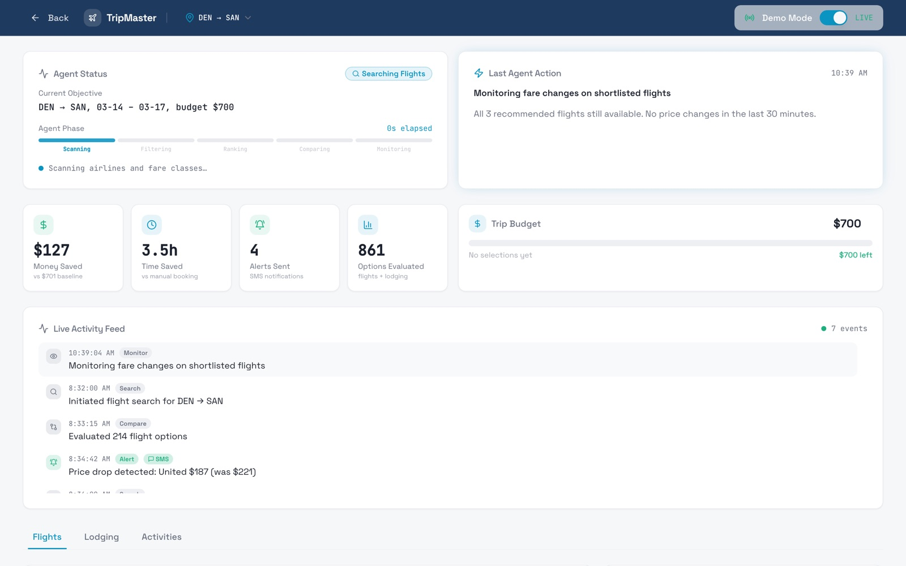

# TripMaster: dashboard

**Mission control for an AI agent that plans your trip, keeps watching it, and texts you when something changes.**

Built in one day at the Redo hackathon (February 2026) with [Jake Nef](https://github.com/jakenef). I designed and built this frontend. Jake built the agent backend in [jakenef/tripmaster](https://github.com/jakenef/tripmaster). We connected the two over a REST API for the demo.

React · TypeScript · Vite · Tailwind · shadcn/ui



## The idea

You text TripMaster where you're going, when, and your budget. An agent finds a round-trip flight and a hotel, then keeps working after you book: it watches for price drops and flight disruptions and texts you when something needs a decision.

SMS is the main interface. The dashboard is where you see what the agent is doing and why.

## What I built

- **Landing page** that explains the flow in four steps: text your trip, the agent searches, the dashboard updates, you get alerts.
- **Agent status.** The current objective, and a phase bar (scanning, filtering, ranking, comparing, monitoring) so you can see how far along the agent is.
- **Impact metrics.** Money saved against a baseline fare, time saved, alerts sent, and options evaluated.
- **Live activity feed** of every agent action, tagged by type (search, compare, alert, SMS).
- **Flights, lodging and activities tabs**, each with the agent's best picks and the preferences that drive them.
- **Trip budget tracker** that updates as options are selected.
- **Controls to simulate a delay or a cancellation**, so judges could watch the agent react in real time.
- **Demo / live toggle.** Live mode reads from Jake's backend. Demo mode replays scripted agent events, so the dashboard works without a server running.

## Design decisions

- **Show the reasoning, not just the result.** An agent that changes your trip on its own needs to earn trust, so the phase bar and activity feed make every step visible.
- **Lead with outcomes.** Money and time saved sit at the top, where a traveller looks first.
- **Demo mode as a first-class feature.** Hackathon backends go down at the worst moment. Demo mode meant the pitch never depended on a live server.

## How it was built

I designed the dashboard and built it quickly with Lovable, then wired it to the backend through a typed API client ([`src/lib/api.ts`](src/lib/api.ts)) for trip state, agent reasoning, logs and the simulation endpoints. Most of the commit history is Lovable's bot, because Lovable commits each change automatically.

## Run it

```bash
npm install
npm run dev
```

It opens in demo mode, so no backend is needed. To connect to the live agent, run [jakenef/tripmaster](https://github.com/jakenef/tripmaster) and set `VITE_API_BASE_URL` (see `.env.example`).
